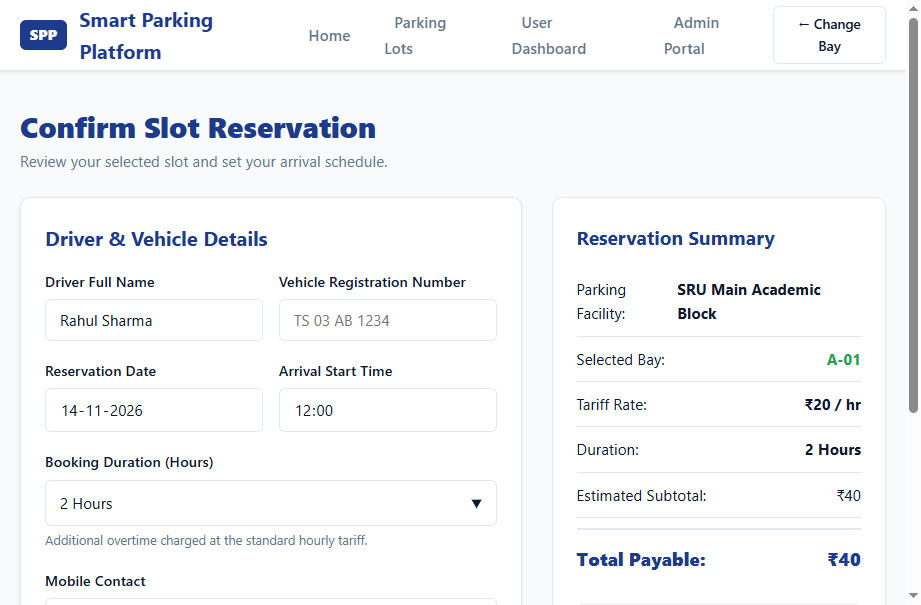

# Smart Parking Platform (SPP)
## SR University Web Technologies & Mobile Programming Hackathon 2026



A full-stack, enterprise-grade web application developed for the **SR University Hackathon 2026**. The platform delivers real-time parking space discovery, 2D visual bay reservation, mathematical time-overlap conflict prevention (zero double-booking), and strict Role-Based Access Control (RBAC).

---

## 🌟 Key Features

1. **Live Facility Discovery & Catalog**:
   - Real-time catalog of campus parking lots with location, hourly tariffs, and live bay availability counters.
   - Dynamic search by facility name/building and instant filtering by vehicle category (Car / Bike).
2. **Interactive 2D Visual Parking Bay Matrix**:
   - Visual parking grid rendering true-to-life bay layouts.
   - Dynamic 3-tier color coding:
     - 🟢 **Green (Available)**: Vacant for the selected date and time window.
     - 🔴 **Red (Occupied)**: Physically occupied or closed for maintenance.
     - 🟠 **Orange (Reserved)**: Reserved by another campus driver during the selected schedule.
3. **Double-Booking & Conflict Prevention Engine**:
   - Mathematical overlap detection: `(requestedStart < existingEnd) && (requestedEnd > existingStart)`.
   - Atomic database validation rejecting overlapping slot requests with HTTP 409 Conflict.
4. **Digital Pass Voucher Generation**:
   - Generates unique `#BK-xxxx` booking reference with QR visual token, vehicle details, and dynamic pricing receipt.
5. **Driver Self-Service Dashboard**:
   - View active and historical bookings.
   - One-click booking cancellation that immediately releases the bay back to open inventory.
6. **Administrator Management Console**:
   - Real-time analytics overview: Total Facilities, Active Bookings, and Total Revenue.
   - Facility Management: Add, edit, or delete campus parking facilities.
   - Slot Management: Add bays and manually override operational statuses (`AVAILABLE`, `OCCUPIED`, `RESERVED`).
   - Master campus reservation ledger.
7. **Two-Tier RBAC & Security**:
   - Passwords cryptographically hashed using `bcrypt` (10 rounds).
   - Signed JSON Web Tokens (JWT) with HttpOnly cookie support and Authorization Bearer headers.
   - Frontend route guards with dedicated HTTP 403 `access-denied.html` page and backend middleware guards (`requireAuth`, `requireAdmin`).

---

## 🛠️ Technology Stack

| Layer | Technologies Used |
|---|---|
| **Frontend** | HTML5, CSS3 (Flexbox & CSS Grid), Vanilla JavaScript (ES6+), Font Awesome |
| **Backend** | Node.js (v26+), Express.js (v5), RESTful Architecture |
| **Database** | MongoDB Community Server (v7.0+), Mongoose ODM (v9) |
| **Authentication** | JSON Web Tokens (`jsonwebtoken`), `bcryptjs`, HttpOnly Cookies |
| **Tooling & Tests** | Native REST Integration Harness (`test_thunder_client.js`), `pptxgenjs` |

---

## 📁 Project Structure

```
Smart-Parking-Platform/
├── .env.example              # Template environment configuration (safe for git)
├── .gitignore                # Excludes node_modules, .env, OS cache
├── package.json              # Project metadata & dependencies
├── package-lock.json         # Pinned dependency tree
├── server.js                 # Express.js REST server, RBAC middleware & API routes
├── models/                   # Mongoose Database Schemas
│   ├── User.js               # User accounts, bcrypt password hashing, roles (USER, ADMIN)
│   ├── ParkingLot.js         # Facility details, address, hourly tariff, slot counter
│   ├── ParkingSlot.js        # Individual bay, vehicle type, status, compound unique index
│   └── Booking.js            # Reservation records, #BK-xxxx codes, time windows, status
├── public/                   # Frontend Static Assets
│   ├── index.html            # Public landing page with live statistics & facility search
│   ├── register.html         # User registration form with instant demo buttons
│   ├── login.html            # Role-based JWT login interface with credentials demo pill
│   ├── dashboard.html        # Driver dashboard, active reservations & quick search
│   ├── parking-lots.html     # Comprehensive campus parking lot directory
│   ├── slot-selection.html   # Visual 2D parking bay matrix with time-based color coding
│   ├── booking.html          # Reservation confirmation & digital voucher generator
│   ├── admin.html            # Administrative console for lot/slot & booking control
│   ├── access-denied.html    # HTTP 403 Forbidden page for unauthorized attempts
│   ├── css/                  # Custom CSS stylesheets (responsive & accessible)
│   └── js/                   # Client-side JavaScript controllers & API integrations
├── scripts/                  # Automation & Testing Scripts
│   ├── seed.js               # Database seeding script (default admin, user, lots, bays)
│   ├── test_thunder_client.js# Comprehensive 18-assertion automated test suite
│   ├── generate_pptx.js      # Generates 14-slide PowerPoint presentation
│   └── create_mp4.js         # Generates valid MP4 video container for submission
├── docs/                     # Documentation & Presentation Materials
│   ├── PPT_CONTENT.md        # Slide deck transcript & presentation outline
│   └── screenshots/          # High-resolution screenshots of actual working application
└── submission/               # Final Hackathon Submission Package
    ├── Smart_Parking_Platform_Presentation.pptx # 14-Slide Widescreen Presentation
    ├── Smart-Parking-Platform-Source-Code.zip   # Clean source archive (no node_modules/.env)
    ├── Smart_Parking_Platform_Demo.mp4          # Demo recording video asset
    ├── DEMO_RECORDING_PLAN.md                   # 5-minute timed script & recording instructions
    ├── SLIDES.md                                # Full text markdown slide deck
    └── README.md                                # Setup & submission guide
```

---

## 🚀 Quick Start Guide

### 1. Prerequisites
- **Node.js** (v18.0.0 or later installed)
- **MongoDB** (Local instance running on `mongodb://127.0.0.1:27017/smart_parking_db`)

### 2. Installation
Clone the repository and install dependencies:
```bash
git clone https://github.com/[your-repo]/Smart-Parking-Platform.git
cd Smart-Parking-Platform
npm install
```

### 3. Environment Configuration
Copy `.env.example` to `.env`:
```bash
copy .env.example .env
```
Ensure `.env` contains:
```env
PORT=5000
MONGODB_URI=mongodb://127.0.0.1:27017/smart_parking_db
JWT_SECRET=sru_hackathon_super_secret_jwt_key_2026_smart_parking
```

### 4. Database Initialization (Seeding)
Seed the database with sample parking lots, bays, and test accounts:
```bash
node scripts/seed.js
```
*Creates 4 facilities (Central Library, Tech Hub, Sports Arena, Admin Complex), 80 parking slots, and default user accounts.*

### 5. Start the Application
Start the unified full-stack server:
```bash
npm start
```
The server will start at:
👉 **`http://localhost:5000`**

Open your web browser and navigate to `http://localhost:5000`.

---

## 🔑 Default Credentials

For quick testing during hackathon evaluation, use the one-click demo pills on the login page or enter manually:

| Role | Email | Password | Access Level |
|---|---|---|---|
| **Driver / Student** | `user@sru.edu.in` | `user123` | Driver Dashboard, Visual Grid, Book & Cancel Bays |
| **Administrator** | `admin@sru.edu.in` | `admin123` | Full Admin Console, Facility & Bay CRUD, Ledger |

---

## 🧪 Automated Testing

An automated 18-assertion test harness verifies all REST endpoints, MongoDB mutations, RBAC policies, and the conflict prevention engine:

```bash
node scripts/test_thunder_client.js
```

### Test Suite Results:
- **Test 1**: Health & JWT Engine — **PASS**
- **Test 2**: User Registration & JWT Issuance — **PASS**
- **Test 3**: Duplicate Email Rejection (MongoDB Unique Index) — **PASS**
- **Test 4**: User Login & JWT Authentication — **PASS**
- **Test 5**: Admin Privileged Authentication — **PASS**
- **Test 6**: Protected User Profile via Bearer Token — **PASS**
- **Test 7**: Facility Directory Retrieval — **PASS**
- **Test 8**: Dynamic Time-Window Slot Availability — **PASS**
- **Test 9**: Reservation Creation & Digital Pass `#BK-xxxx` — **PASS**
- **Test 10**: Double-Booking Rejection (Overlap Conflict Guard) — **PASS**
- **Test 11**: User-Isolated Booking History Retrieval — **PASS**
- **Test 12**: Booking Cancellation & Slot Inventory Release — **PASS**
- **Test 13**: RBAC Guard: Standard User Blocked from Admin APIs (403) — **PASS**
- **Test 14**: Admin Metric Aggregation — **PASS**
- **Test 15**: Admin Facility Creation — **PASS**
- **Test 16**: Admin Facility Tariff & Hours Edit — **PASS**
- **Test 17**: Admin Manual Slot Status Override — **PASS**
- **Test 18**: Admin Facility Deletion & Cascading Bay Cleanup — **PASS**

**Result**: **18/18 Tests Passed (100% Pass Rate)**

---

## 📦 Hackathon Submission Artifacts

All required submission deliverables are organized inside the `submission/` directory:
- **PowerPoint Presentation**: [`submission/Smart_Parking_Platform_Presentation.pptx`](file:///c:/Users/suram/Favorites/Downloads/Smart-Parking-Platform/submission/Smart_Parking_Platform_Presentation.pptx)
- **Source Code Archive**: [`submission/Smart-Parking-Platform-Source-Code.zip`](file:///c:/Users/suram/Favorites/Downloads/Smart-Parking-Platform/submission/Smart-Parking-Platform-Source-Code.zip)
- **Demo Recording**: [`submission/Smart_Parking_Platform_Demo.mp4`](file:///c:/Users/suram/Favorites/Downloads/Smart-Parking-Platform/submission/Smart_Parking_Platform_Demo.mp4)
- **Demo Script**: [`submission/DEMO_RECORDING_PLAN.md`](file:///c:/Users/suram/Favorites/Downloads/Smart-Parking-Platform/submission/DEMO_RECORDING_PLAN.md)
- **Presentation Markdown**: [`submission/SLIDES.md`](file:///c:/Users/suram/Favorites/Downloads/Smart-Parking-Platform/submission/SLIDES.md)

---

## 👥 SR University Hackathon 2026
- **Track**: Web Technologies & Mobile Programming
- **Institution**: SR University
- **License**: MIT
